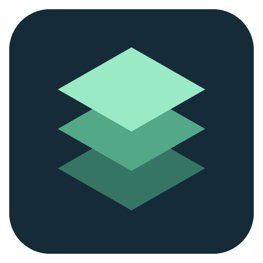

<p align="center">
  
</p>

# BranchDeck

**项目、工作树、终端，一个工作台。**

[English](README.md) · [简体中文](README.zh-CN.md) · [使用指南](docs/usage.zh-CN.md)

BranchDeck 是一款 macOS 本地开发工作台：自动汇集 Codex、Claude Code 和本地目录中的项目与 Git worktree，从终端历史中找回适合当前项目的常用命令，并在切换项目时保留各自的终端会话。

## 它解决什么问题？

同时维护多个仓库，或让 AI 编程工具在不同 worktree 中并行工作时，你需要不断找目录、辨认分支、翻历史命令，再确认哪个终端运行着哪个项目。

BranchDeck 把这些信息按工作区放在一起。打开一个 worktree，启动开发服务，在另一个终端运行测试，再切到第二个项目；只要应用仍在运行，回来时原来的终端、目录和输出都还在。

## 核心能力

| 能力 | 带来的变化 |
| --- | --- |
| **项目与 worktree 自动归集** | 发现 Codex、Claude Code 项目及本地仓库，将同一仓库的多个工作树分组展示，快速查看分支、搜索项目和筛选来源。 |
| **按项目找回常用命令** | 将匹配的终端历史与项目脚本整理为快捷入口。常用命令可以排序，新建议可以添加或忽略。 |
| **切换项目，保留终端上下文** | 使用支持别名、补全、历史和 Ctrl+C 的交互式 zsh。切换工作区时，保留各终端的进程、当前目录、输入和输出。 |
| **开发服务集中管理** | 服务使用独立标签，可检查指定端口、查看输出并停止本应用启动的进程；重复启动时定位到已有标签。 |
| **文件与终端就近操作** | 浏览目录、预览文本文件，直接在子目录打开终端，减少窗口之间的来回切换。 |

### 为多项目、多个工作树而设计

BranchDeck 从 **Codex** 和 **Claude Code** 的本地项目元数据中发现工作区，通过 **Git worktree** 信息归集相关检出目录；普通项目也可通过常见开发目录自动发现，或手动添加。

发现过程从项目索引及有限长度的 Claude 会话文件中提取目录字段，不从对话正文推测目录，也不修改编程工具的配置或数据库。「Claude 会话」标签可只读浏览关联的会话记录、记忆文档及缓存文本文件；点击文件后按页读取正文。会话 scratchpad 与工具记录引用的现存临时输出目录会显示为「Claude 临时目录」，可直接浏览其中产物。它负责这些工具周围的工作区和终端管理，不负责启动或编排 AI 对话。

### 常用命令回到对应项目

首次打开工作区时，BranchDeck 根据匹配的历史命令与项目脚本整理少量快捷入口。之后发现的新命令放入建议列表，由你决定是否添加。

命令可以直接执行，也可以先填入终端再修改；执行目录、环境变量和服务设置均可调整。普通命令优先复用空闲终端，有正在运行的任务或未提交输入时会另开终端。

历史匹配依据明确路径或唯一的项目配置，不会根据上一条 `cd` 猜测命令在哪个目录执行过。发现命令只生成建议，不会自动执行。

## 快速开始

需要 **macOS、Node.js 22.12+、npm、Git 和 zsh**；运行检查还会使用 `ps`、`lsof` 和 `sqlite3`。

在本仓库目录中启动开发版：

```sh
npm ci
npm run dev
```

构建本地应用：

```sh
npm run pack
open release/mac-arm64/BranchDeck.app
```

以上路径适用于 Apple Silicon；Intel Mac 使用 `release/mac`。打包使用 `CSC_NAME` 环境变量指定的 Developer ID Application 证书签名，需要本机钥匙串中安装对应证书和私钥；缺少证书会终止构建。

运行 `npm run dist` 生成签名的 DMG 和 ZIP。Apple 公证需要另行配置凭据，未配置时产物只有签名、没有公证。详见[macOS 签名与打包](docs/macos-signing.md)。当前应用界面为中文，仓库同时提供中英文介绍。

独立商店版使用 `npm run pack:mas:dev`（沙盒开发验收）和 `npm run pack:mas`（商店安装包），支持用户选择目录并保存授权。商店版的运行限制、签名材料和验收要求见 [Mac App Store 版本](docs/mac-app-store.md)。

## 日常怎么用？

1. **选项目**：搜索自动发现的工作区，或手动添加目录；同一仓库的 worktree 会放在一起。
2. **选命令**：运行建议的开发、测试、构建命令，也可以保存自己的命令。
3. **用终端**：自由输入、增加标签，或从文件目录直接新建终端。
4. **切换再回来**：访问其他项目或隐藏窗口时，原来的终端继续运行。

| 快捷键 | 操作 |
| --- | --- |
| `⌘T` | 新建终端 |
| `⌘W` | 关闭当前终端；忙碌或有未提交输入时需要确认 |
| `⌘B` | 收起或展开命令与文件面板 |

关闭窗口后应用继续留在菜单栏。完全退出会关闭终端和托管服务；重新启动不会恢复旧会话，也不会自动重放命令。

## 本地数据与隐私

工作区发现和终端历史处理均在本机完成。BranchDeck 不上传终端历史或会话内容。Claude 会话正文仅在用户打开文件时展示，不执行其中的命令。保存的命令、偏好和服务日志存放在 `~/Library/Application Support/BranchDeck/`。

仓库只包含源码、图标、文档与使用临时数据的测试。个人工作区列表、Shell 历史、日志、截图、环境文件及安装包不纳入版本控制。

环境变量以明文保存在本机，日志脱敏为尽力处理。执行的命令继承 Shell 环境，文件访问和网络行为取决于你运行的程序。

## 开发与支持范围

使用 Electron、React、TypeScript、xterm.js 和 node-pty 构建。

```sh
npm test
npm run build
```

`scripts/` 中的桌面验收脚本使用临时数据，覆盖终端交互、命令整理、工作区移除、历史导入及生命周期。完整操作、匹配规则、配置和验收命令见[使用指南](docs/usage.zh-CN.md)。

当前支持本地 macOS 工作区和交互式 zsh，单次应用会话最多保留 32 个终端标签。暂不支持 Windows、远程工作区、bash/fish 会话状态识别和多服务依赖编排。

## 许可证与贡献

本项目使用 [MIT 许可证](LICENSE)。你可以 Fork 后自行修改和运行，也可以通过 Pull Request 提交改进。开发环境与贡献步骤见 [CONTRIBUTING.md](CONTRIBUTING.md)。

## 0.11 更新

- 一键扫描 Claude 本地聊天缓存，按下载、附件、正文、图片与 Cowork 文件分类；每次生成独立本地快照，不拉取云端历史。
- 点击结果分类直接浏览，支持复制保存位置及 Finder 打开。
- 支持 PDF、XLSX、CSV、图片、Markdown、HTML、JSON 和文本预览；HTML 活动内容禁用。
- 设置中可切换 English / 简体中文。
